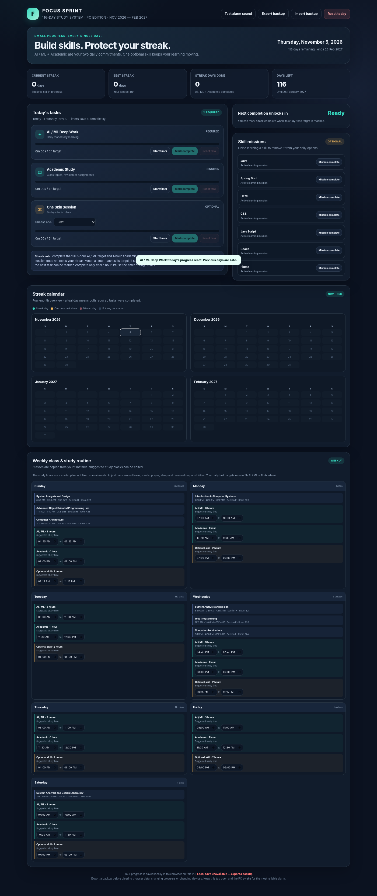

# Focus Sprint — Study Planner

A lightweight, offline-first study planner for a four-month learning challenge (5 November 2026–28 February 2027). It runs locally in a web browser and includes a Windows launcher.

## Features

- **Daily required goals:** AI/ML study (3 hours) and Academic study (1 hour).
- **Optional skill session:** 2 hours for one selected active mission: Java, Spring Boot, HTML, CSS, JavaScript, React, or Figma.
- **Streak tracking:** a day counts only when both required goals are completed.
- **Study timer and alarm:** one active timer at a time, with an in-browser sound alarm when the target is reached.
- **Completion cooldown:** a one-hour cooldown applies before the next task can be marked complete.
- **Mission management:** mark a skill mission complete to remove it from the active mission list.
- **Safe daily reset:** reset one task or today's tasks without clearing previous-day streak history or completed missions.
- **Backup and restore:** export planner data to JSON and import it later.
- **Class and weekly study schedule:** includes the timetable and editable suggested study blocks.

## Run on Windows

1. Download or clone this repository.
2. Keep all files in the same folder.
3. Double-click `START_FOCUS_SPRINT.bat`.
4. The launcher uses PowerShell and, when available, Python/Anaconda's built-in HTTP server. It opens the planner in your default browser.
5. In the app, click **Test alarm sound** once and allow browser sound if prompted.

You can also open `Focus_Sprint_Study_Planner_PC.html` directly in Chrome or Edge. The local-server launcher is recommended for more reliable browser storage.

## Data and backup notes

- Planner progress is saved in the browser's local storage on the current PC and browser profile. It is not committed to GitHub.
- Always use the same browser profile and the same launch method/address for day-to-day use.
- Use **Export backup** periodically and keep the downloaded JSON file somewhere safe.
- Use **Import backup** to restore a previous export. Importing replaces the current browser's planner data, so export the current data first if you may need it.
- Do not clear the browser's site data for the planner unless you have a backup.
- Keep the planner tab open and the PC awake while a timer is running. Browser alarms may be delayed if the PC sleeps or the tab/browser is closed.

## Project files

| File | Purpose |
|---|---|
| `Focus_Sprint_Study_Planner_PC.html` | Main self-contained planner app |
| `START_FOCUS_SPRINT.bat` | Windows double-click launcher |
| `Start_Focus_Sprint.ps1` | PowerShell script used by the launcher |
| `screenshots/app-preview.png` | Screenshot of the planner interface |

## Privacy

The app includes a class timetable and suggested study schedule. Review those details before making this repository public. Keep the repository private if you do not want your timetable shared.

## Technology

HTML, CSS, and vanilla JavaScript. No package installation or external JavaScript framework is required to run the planner.
